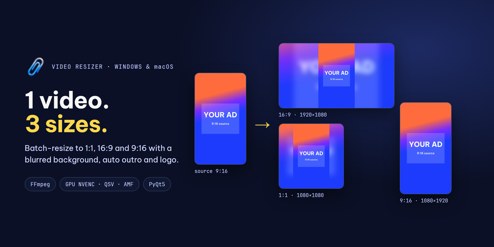
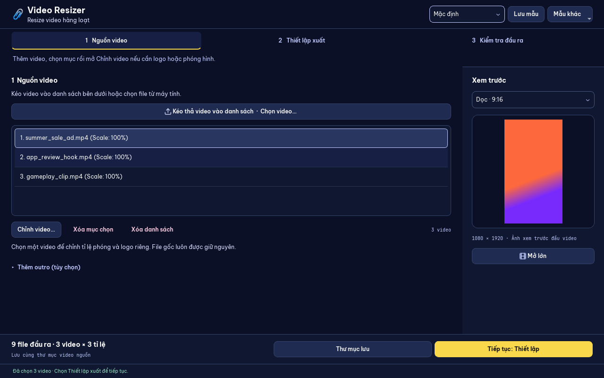
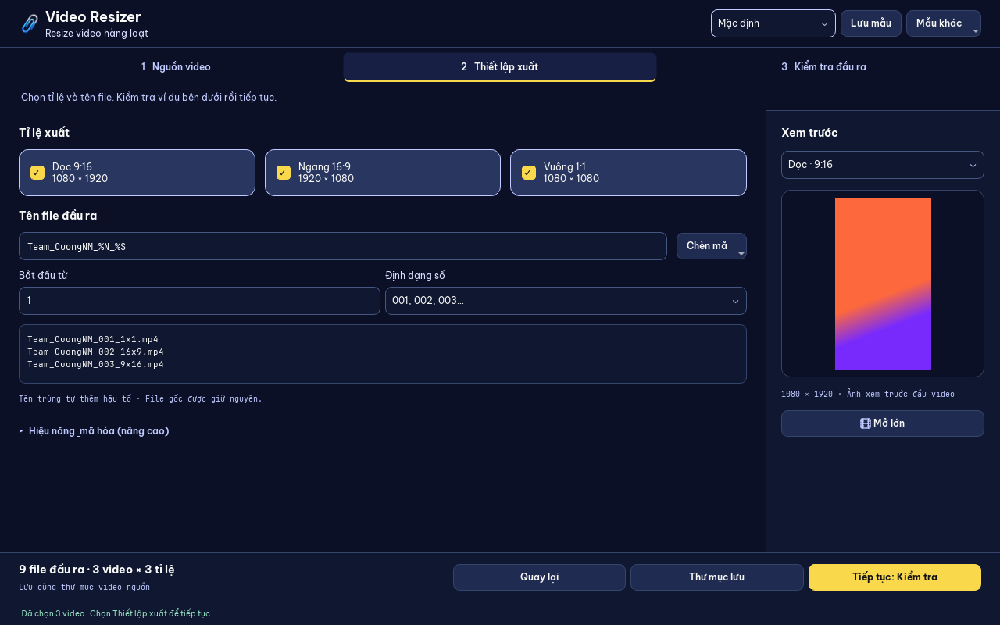
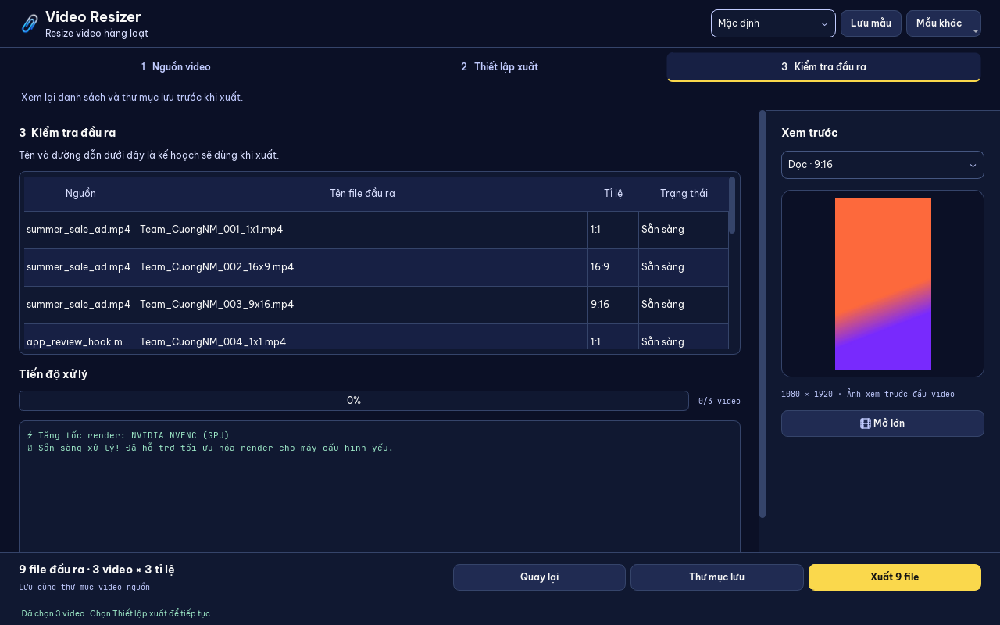

<p align="center">
  
</p>

<p align="center">
  <a href="https://github.com/tivicicreative2024/VideoResizerAuto/releases/latest"></a>
  <a href="https://github.com/tivicicreative2024/VideoResizerAuto/releases"></a>
  
  
  <a href="LICENSE"></a>
</p>

<p align="center"><a href="README.md">Tiếng Việt</a> · <b>English</b></p>

Video Resizer batch-converts ad videos to **Square 1:1**, **Landscape 16:9** and **Portrait 9:16** in one click: the main video sits centred over a blurred copy of itself, a per-ratio outro is appended, a logo is overlaid and files are named from a template.

## ⬇️ Download

**Windows 10/11 (64-bit):** grab `VideoResizer-Setup-<version>-win64.exe` from the [latest release](https://github.com/tivicicreative2024/VideoResizerAuto/releases/latest), run it and follow the wizard. Python, Qt and FFmpeg are bundled; no admin rights needed.

> The installer is unsigned, so Windows may show an *unknown publisher* warning. Check its SHA256 against the `SHA256SUMS` file attached to the release.

**macOS:** run from source (see [Run from source](#-run-from-source)).

## 🖼️ Screenshots

The app UI is in Vietnamese.

| 1 · Source videos | 2 · Export settings | 3 · Review outputs |
|:---:|:---:|:---:|
|  |  |  |

## ✨ Features

| Feature | Details |
|---|---|
| 📐 **Three ratios at once** | `1080×1080`, `1920×1080`, `1080×1920`; per-file zoom of the main video. |
| 🌫️ **Fast blurred background** | Bicubic pyramid blur, 5–6× faster than a plain Gaussian, in three modes: *Low-spec*, *Balanced*, *High quality*. |
| 🎞️ **Outro stitching** | Separate outro for Square / Landscape / Portrait; size, 30 fps and stereo audio normalised automatically. |
| 🎨 **Logo / watermark** | PNG, JPG, WebP; drag it into place in the preview, copy it to the whole list. |
| 🏷️ **Naming templates** | `%F` source name · `%N` running number · `%S` ratio · `%D` date. `Team_CuongNM_%N_%S` → `Team_CuongNM_001_1x1.mp4`. |
| 🛡️ **Never overwrites** | Name clashes get `-2`, `-3`; renders go to a staging folder and only finished files are moved out. |
| ⚡ **Automatic GPU** | NVIDIA NVENC, Intel QSV, AMD AMF, Apple VideoToolbox; falls back to CPU if the GPU encode fails. |
| 📂 **Profiles** | Save outros, logo, zoom, render mode and naming rule per project. |

## 🛠️ Run from source

```bash
pip install -r requirements.txt
python video_resizer.py
```

On Windows you can double-click `run_video_resizer.bat`; on macOS, `run_video_resizer.command`.

**Packaging:**

| Target | Command | Output |
|---|---|---|
| Windows `.exe` | `build_exe.bat` | `dist\VideoResizer\VideoResizer.exe` |
| Windows installer | `build_installer.bat` (needs Inno Setup 6) | `dist\VideoResizer-Setup-<version>-win64.exe` |
| macOS `.app` | `pyinstaller VideoResizer.spec` | `dist/VideoResizer.app` |

**Tests:**

```bash
.venv\Scripts\python.exe -m unittest discover -v
.venv\Scripts\python.exe test_packaging.py
```

## 📁 Layout

```text
video_resizer.py     Main window, FFmpeg worker, encoder detection
resizer_ui.py        Three-step UI
ui_theme.qss         Theme
output_naming.py     Naming templates and no-overwrite planning
installer.iss        Inno Setup installer
assets/              Fonts, icons
test_*.py            Tests
```

## 📝 Changelog

See [CHANGELOG.md](CHANGELOG.md).

## 📄 License

[MIT](LICENSE). Third-party components: [THIRD-PARTY.txt](THIRD-PARTY.txt).
