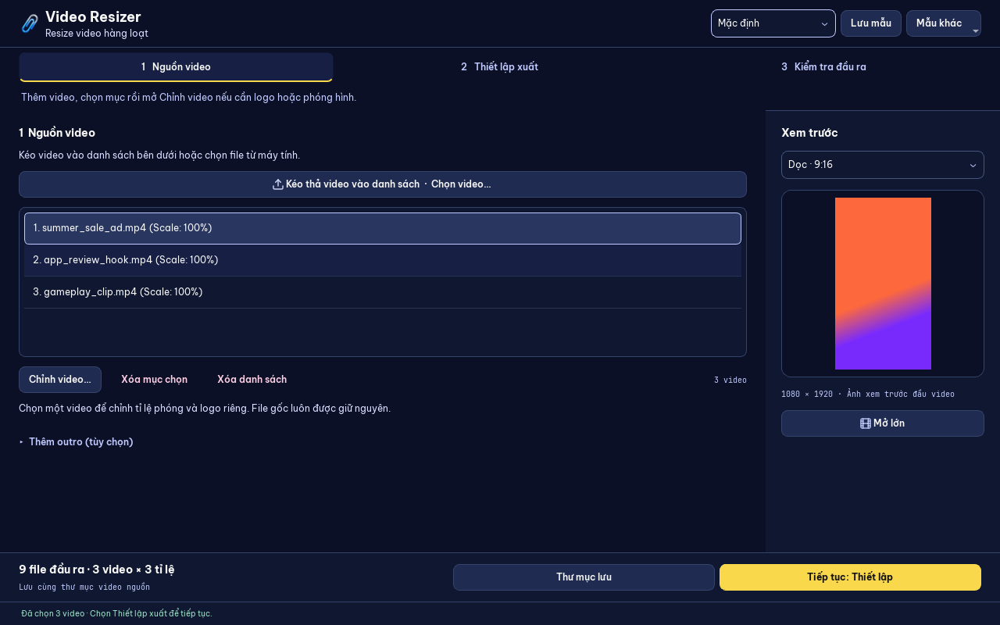
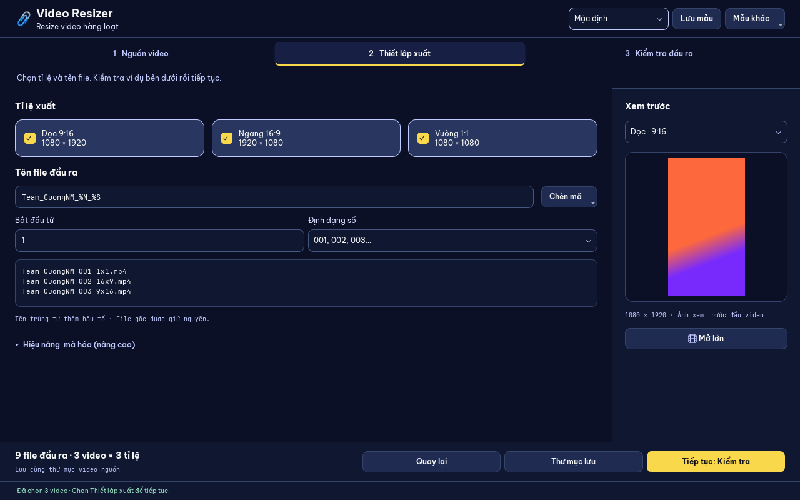
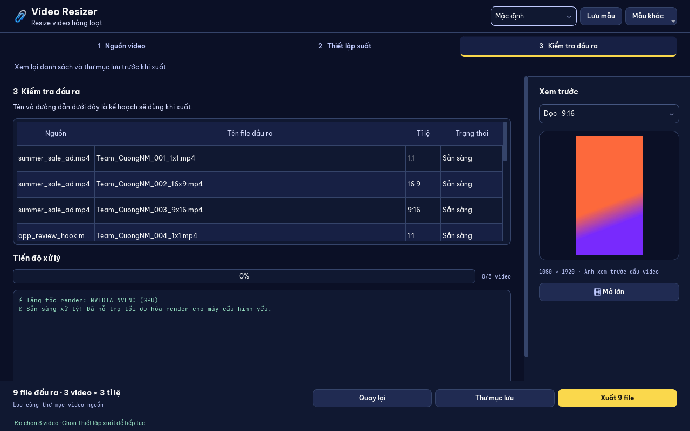

<p align="center">
  
</p>

<p align="center">
  <a href="https://github.com/tivicicreative2024/VideoResizerAuto/releases/latest"></a>
  <a href="https://github.com/tivicicreative2024/VideoResizerAuto/releases"></a>
  
  
  <a href="LICENSE"></a>
</p>

<p align="center"><b>Tiếng Việt</b> · <a href="README.en.md">English</a></p>

Video Resizer chuyển hàng loạt video quảng cáo ra **Vuông 1:1**, **Ngang 16:9** và **Dọc 9:16** trong một lần bấm: video chính nằm giữa trên nền mờ của chính nó, tự ghép outro theo từng tỉ lệ, chèn logo và đặt tên file theo mẫu.

## ⬇️ Tải về

**Windows 10/11 (64-bit):** tải `VideoResizer-Setup-<version>-win64.exe` ở [bản phát hành mới nhất](https://github.com/tivicicreative2024/VideoResizerAuto/releases/latest), chạy và làm theo hướng dẫn. Đã kèm sẵn Python, Qt và FFmpeg; không cần quyền admin.

> Bộ cài chưa ký số nên Windows có thể cảnh báo *unknown publisher*. So SHA256 với file `SHA256SUMS` đi kèm release.

**macOS:** chạy từ mã nguồn (xem [Chạy từ mã nguồn](#-chạy-từ-mã-nguồn)).

## 🖼️ Giao diện

| 1 · Nguồn video | 2 · Thiết lập xuất | 3 · Kiểm tra đầu ra |
|:---:|:---:|:---:|
|  |  |  |

## ✨ Tính năng

| Tính năng | Chi tiết |
|---|---|
| 📐 **3 tỉ lệ cùng lúc** | `1080×1080`, `1920×1080`, `1080×1920`; phóng to video chính riêng cho từng file. |
| 🌫️ **Nền mờ nhanh** | Bicubic pyramid blur nhanh gấp 5–6 lần Gaussian thường, 3 chế độ: *Máy yếu*, *Cân bằng*, *Chất lượng cao*. |
| 🎞️ **Ghép outro** | Outro riêng cho Vuông / Ngang / Dọc; tự chuẩn hóa kích thước, 30 fps và âm thanh stereo. |
| 🎨 **Logo / watermark** | PNG, JPG, WebP; kéo thả vị trí trong cửa sổ xem trước, sao chép cho cả danh sách. |
| 🏷️ **Đặt tên theo mẫu** | `%F` tên gốc · `%N` số thứ tự · `%S` tỉ lệ · `%D` ngày. Ví dụ `Team_CuongNM_%N_%S` → `Team_CuongNM_001_1x1.mp4`. |
| 🛡️ **Không ghi đè** | Tên trùng tự thêm `-2`, `-3`; render vào thư mục tạm, chỉ đưa file hoàn chỉnh ra ngoài. |
| ⚡ **GPU tự động** | NVIDIA NVENC, Intel QSV, AMD AMF, Apple VideoToolbox; GPU lỗi tự chuyển sang CPU. |
| 📂 **Mẫu (profiles)** | Lưu outro, logo, tỉ lệ, chế độ render và quy tắc tên cho từng dự án. |

## 🛠️ Chạy từ mã nguồn

```bash
pip install -r requirements.txt
python video_resizer.py
```

Windows có thể bấm đúp `run_video_resizer.bat`; macOS bấm đúp `run_video_resizer.command`.

**Đóng gói:**

| Mục tiêu | Lệnh | Kết quả |
|---|---|---|
| Windows `.exe` | `build_exe.bat` | `dist\VideoResizer\VideoResizer.exe` |
| Windows bộ cài | `build_installer.bat` (cần Inno Setup 6) | `dist\VideoResizer-Setup-<version>-win64.exe` |
| macOS `.app` | `pyinstaller VideoResizer.spec` | `dist/VideoResizer.app` |

**Kiểm tra:**

```bash
.venv\Scripts\python.exe -m unittest discover -v
.venv\Scripts\python.exe test_packaging.py
```

## 📁 Cấu trúc

```text
video_resizer.py     Cửa sổ chính, worker FFmpeg, chọn encoder
resizer_ui.py        Giao diện 3 bước
ui_theme.qss         Theme
output_naming.py     Mẫu tên file và chống ghi đè
installer.iss        Bộ cài Inno Setup
assets/              Font, icon
test_*.py            Test
```

## 📝 Nhật ký thay đổi

Xem [CHANGELOG.md](CHANGELOG.md).

## 📄 Bản quyền

[MIT](LICENSE). Thư viện bên thứ ba: [THIRD-PARTY.txt](THIRD-PARTY.txt).
